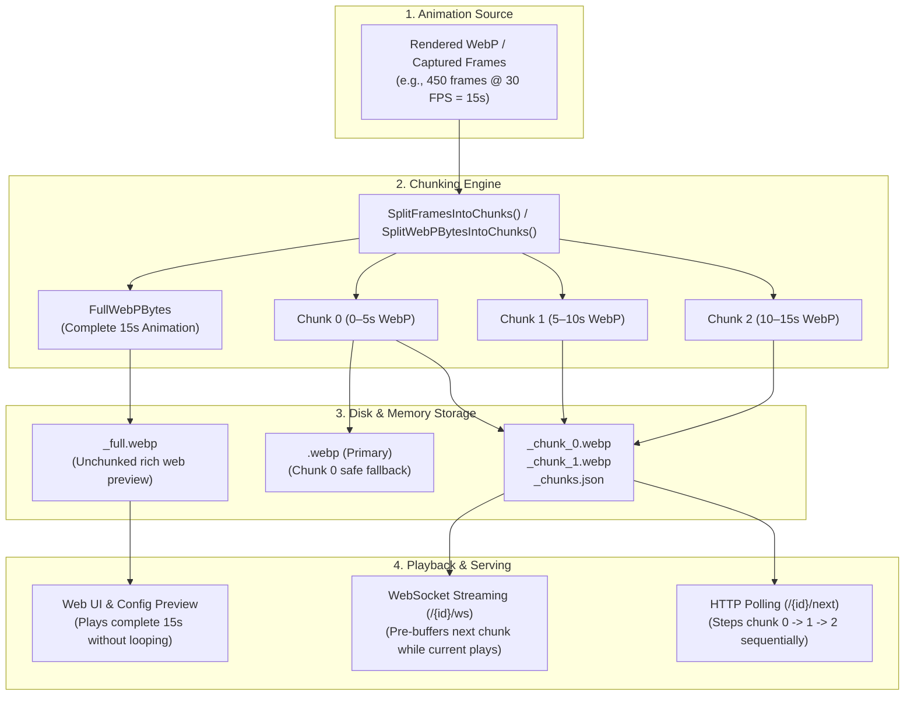

# Multi-Chunk Animation Architecture

This document provides a comprehensive overview of the multi-chunk animation architecture in Tronbyt Server, detailing how long, high-framerate WebP animations are rendered, partitioned, stored, and streamed seamlessly to both memory-constrained microcontrollers and modern web browsers.

---

## 1. The Hardware Problem

Microcontrollers like the ESP32 (used in Tidbyt Gen 1, Waveshare MatrixPortal, etc.) have strict RAM and hardware buffer constraints:

* **Tidbyt Gen 1 & ESP32:** ~160 KB firmware image buffer limit (safe for double-buffering; chunks approaching 200 KB cause heap allocation exhaustion and "mind explode" fallbacks).
* **ESP32-S3 & Matrix Wide devices:** ~450–460 KB firmware buffer limit.
* **Pixoticker:** ~50 KB buffer limit.
* **Raspberry Pi / Tronberry:** 5+ MB (effectively unconstrained).

A smooth 30 FPS WebP animation spanning a 10–15 second dwell time typically compresses to **600 KB – 2 MB**. When pushed as a single monolithic image to an ESP32:
1. The hardware demuxer runs out of memory.
2. The firmware crashes or falls back to displaying the "mind explode" error image.
3. Simply shortening the animation causes devices to loop a tiny 3–5 second clip repeatedly across their dwell window.

The **Multi-Chunk Architecture** solves this by intelligently partitioning long animations into hardware-safe sequential chunks that play back seamlessly without memory exhaustion or awkward premature looping.

---

## 2. High-Level Architecture

---

## 3. The Core Chunking Engine (`internal/chunker/chunker.go`)

Both native Starlark/Pixlet apps and incoming frame streams utilize the shared `internal/chunker` engine.

When an app is rendered:
* **Starlark / Pixlet Apps:** When a rendered Starlark WebP animation exceeds the device's hardware buffer budget (`GetMaxChunkSizeForDevice`), `SplitWebPBytesIntoChunks` decodes the animation via `webp.NewAnimationDecoder` and partitions the frames into hardware-compliant chunks.
* **Frame Buffers:** High-framerate frame sequences are passed directly to `SplitFramesIntoChunksWithDuration`.

The chunking process proceeds as follows:

1. **Unchunked Bypass:**
   If `maxChunkSize <= 0` (used for web previews), the engine encodes all captured frames into a single continuous WebP animation and returns immediately.
2. **Single-Chunk Validation:**
   If all frames fit within both `maxChunkSize` and `maxFramesPerChunk` (e.g. on a Raspberry Pi or for a very short dwell time), the entire animation is preserved as a single chunk.
3. **Timing & Frame Rate Preservation:**
   The chunker extracts each frame's exact timestamp from the rendered WebP metadata. Individual frame durations are never compressed or squashed into dwell time windows, preserving natural playback speed and respecting `show_full_animation: true` while preventing microcontroller RTOS task watchdog timeouts caused by sub-tick frame delays.
4. **Balanced Multi-Chunk Partitioning:**
   When the animation exceeds device bounds, the engine finds the minimum $K \ge 2$ balanced chunks that fit under `maxChunkSize` and `maxChunkDurationMs`, avoiding awkward runt stragglers and intermediate freezing seams.
5. **Full Animation Attachment (`FullWebPBytes`):**
   The chunker attaches the complete, unchunked animation binary (`FullWebPBytes`) to Chunk 0. This ensures downstream callers have access to both the partitioned hardware chunks and the full browser-ready animation from a single render pass.

---

## 4. Dual-Asset Disk Storage Pattern (`internal/server/server.go`)

When chunks are saved to `data/webp/<device_id>/` via `saveAppChunks`:

| File | Purpose | Audience | Size Budget |
| :--- | :--- | :--- | :--- |
| `<appBasename>_full.webp` | Complete unchunked animation across all dwell seconds | Web browser UI, dashboard, config preview | Unconstrained (e.g., 600 KB – 2 MB) |
| `<appBasename>.webp` (Primary) | Chunk 0 only | Fallback for direct HTTP file fetches | Strictly under device `maxChunkSize` (e.g., &le; 200 KB) |
| `<appBasename>_chunk_<n>.webp` | Individual hardware animation slices | WebSocket & HTTP sequential streaming | Strictly under device `maxChunkSize` |
| `<appBasename>_chunks.json` | Metadata manifest tracking chunk files and millisecond durations | Tronbyt rotation & streaming engines | Minimal JSON |

*Note: Old chunk files are cleaned up before saving to prevent orphaned chunks if the app's dwell time or chunk count decreases.*

---

## 5. Playback & Delivery Mechanisms

### A. WebSocket Streaming (`internal/server/websockets.go`)

WebSocket devices (`/ws/{device_id}`) utilize hardware double-buffering for seamless playback:

1. **Chunk 0 Delivery:**
   - Server writes JSON metadata: `{"dwell_secs": chunkDwell}` (where `chunkDwell = max(1, DurationMs/1000)`).
   - Server sends Chunk 0 binary message with `{"immediate": true}`.
   - Chunk 0 immediately takes over the hardware display.
2. **Double-Buffered Pre-Streaming:**
   - On v1+ firmware, the device returns a `displaying` acknowledgement as soon as Chunk 0 renders.
   - The server immediately writes Chunk 1 into the hardware's secondary queue while Chunk 0 is actively playing on screen.
   - When Chunk 0's playback finishes, the hardware flips to Chunk 1 with zero latency, flicker, or gap.
3. **Legacy Firmware Support:**
   - For legacy firmware (without double-buffering), the server times chunk playback using high-precision timers and forces `{"immediate": true}` on successive chunks to transition smoothly.
4. **Rotation Advancement:**
   - Once the final chunk completes playback, the write loop advances to the next app in normal rotation.

### B. HTTP Polling (`internal/server/rotation.go` & `handlers_device_api.go`)

For devices polling `GET /{id}/next`:

1. The server maintains an in-memory cursor per device: `deviceCurrentChunkApp[device.ID]` and `deviceChunkIndices[device.ID]`.
2. **Step 1:** Poll 1 returns Chunk 0 with response header `Tronbyt-Dwell-Secs: 5`.
3. **Step 2:** Poll 2 returns Chunk 1 with `Tronbyt-Dwell-Secs: 5`.
4. **Step 3:** Poll 3 returns Chunk 2 with `Tronbyt-Dwell-Secs: 5`.
5. **Advancement:** After the final chunk is served, the tracking cursor is cleared and the subsequent `/next` request advances rotation to the next installed app.

---

## 6. Web UI & Live Previews (`internal/server/handlers_app.go`)

### Web Configuration Preview (`GET /devices/{id}/installations/{iname}/preview`)
Browsers are not constrained by microcontroller memory limits:
* The web preview endpoint checks for `<appBasename>_full.webp` on disk and serves it immediately.
* If the app has not yet completed a background rotation cycle, the server renders the app on-demand with `MaxChunkSize: 0` for the full dwell time window (`dwellSecs * 1000`), caches the result to `<appBasename>_full.webp`, and serves it.
* The preview in the browser is always a complete, continuous animation spanning the entire dwell window without looping early.

### Device Push Previews (`POST /devices/{id}/{iname}/preview`)
When a user clicks **"Preview on Device"**:
1. The server renders chunks according to the target device's hardware budget.
2. Chunk 0 is safely saved to the device's ephemeral push image storage (`pushed/<iname>.webp`) ensuring HTTP fallbacks never overflow device buffers.
3. The server broadcasts a `DevicePreviewMessage` containing all rendered chunks.
4. Active WebSocket connections immediately interrupt current rotation and stream Chunk 0 &rarr; Chunk 1 &rarr; Chunk 2 in sequence, allowing the user to inspect the full animation live on their hardware without overwriting persistent app state.

---

## 7. Pushed Apps & API Image Pushes (`internal/server/handlers_api.go`)

The chunking engine automatically validates and partitions images and animations delivered via the REST API endpoints:
* `POST /v0/devices/{id}/push` (pre-rendered WebP animations)
* `POST /v0/devices/{id}/push_app` (rendered Starlark applets)

### Persistent Pushed Apps (with `installationID`)
1. If the animation exceeds the device's `maxChunkSize`, `processPushedImage` partitions it into sequential chunks via `chunker.SplitWebPBytesIntoChunks`.
2. `saveAppChunks` writes:
   - Chunk 0 to `webp/<device>/pushed/<installationID>.webp` (guaranteed safe primary image).
   - All individual chunk files (`pushed-<iname>_chunk_*.webp`), full preview (`pushed-<iname>_full.webp`), and metadata (`pushed-<iname>_chunks.json`).
3. **WebSocket:** Broadcasts `DevicePreviewMessage` so active devices stream all chunks in real-time.
4. **HTTP Polling:** When rotation reaches the pushed app, the server steps through Chunk 0 &rarr; 1 &rarr; 2 across consecutive `/next` requests.
5. **Deletion:** `DELETE /v0/devices/{id}/installations/{iname}` automatically removes all chunk files, metadata, and evicts in-memory cache entries.

### Ephemeral Image Pushes (without `installationID`)
1. For animations without an `installationID`, oversized payloads are partitioned into temporary chunks.
2. **WebSocket:** Broadcasts `DevicePreviewMessage` to immediately interrupt and stream the complete multi-chunk animation.
3. **HTTP Polling:** Chunk 0 is written to `webp/<device>/pushed/__<timestamp>.webp` so an HTTP client fetching `/next` receives a safe image within its buffer limits rather than a memory crash.

---

## 8. Device Tier Specifications

| Device Type | Identifiers | Max Chunk Size | Max Chunk Duration | Target Firmware Buffer |
| :--- | :--- | :--- | :--- | :--- |
| **Raspberry Pi / Tronberry** | `DeviceRaspberryPi*`, `DeviceTronberry*` | **5,242,880 B** (5 MB) | No duration limit (`0`) | Unlimited |
| **ESP32-S3 & Matrix Wide** | `DeviceTronbytS3Wide`, `DeviceMatrixPortalWide`, `DeviceMatrixPortalSquare`, `DeviceTronbytS3`, `DeviceMatrixPortal`, `DeviceMatrixPortalWS`, `DeviceWaveshareS3`, `DeviceTidbytGen2` | **450,000 B** (450 KB) | Governed by byte budget (`0`) | 460,000 B |
| **Tidbyt Gen 1 & Standard ESP32** | `DeviceTidbytGen1` | **160,000 B** (160 KB) | Governed by byte budget (`0`) | 220,000 B |
| **Pixoticker** | `DevicePixoticker` | **50,000 B** (50 KB) | Governed by byte budget (`0`) | 60,000 B |

---

## 9. Configuration Options

| Environment Variable | Default | Description |
| :--- | :--- | :--- |
| `TRONBYT_MAX_CHUNK_SIZE_ESP` | `160000` (160 KB) | Maximum chunk size budget for ESP32 and Tidbyt Gen 1 hardware. |
| `TRONBYT_MAX_CHUNK_SIZE_S3` | `450000` (450 KB) | Maximum chunk size budget for ESP32-S3, Matrix Wide, and Tidbyt Gen 2 hardware. |
| `TRONBYT_MAX_CHUNK_SIZE_RPI` | `5242880` (5 MB) | Maximum chunk size budget for Raspberry Pi and Tronberry hardware. |
